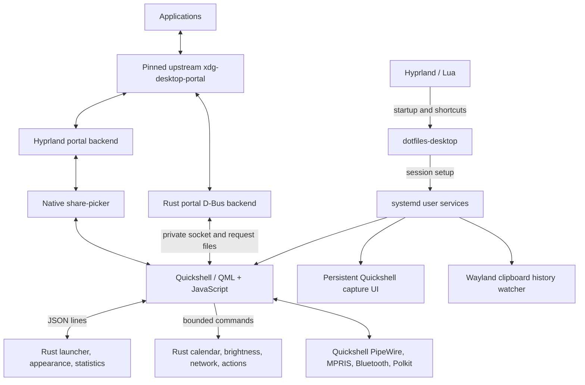

# Native desktop helpers

One Rust package builds `dotfiles-desktop`. The desktop UI remains QML/JavaScript
in Quickshell, and Hyprland policy remains Lua.



The same executable supports these command groups:

| Command | Responsibilities |
|---|---|
| `desktop` | Session services, removable-media automount, Bluetooth/network credential agents, shortcuts, application catalog/launching, clipboard, media and brightness keys |
| `shell` | System statistics, appearance, Ethernet status, speed measurements, brightness controls, power actions |
| `launcher` | Persistent search/action worker, two bounded queues for local and file results |
| `agenda` | Existing EDS calendars and GWeather world clocks |
| `capture` | Capture sessions, frozen images, image export, recording supervision and composition |
| `portal` | D-Bus backend, sharing picker, preview and response writing |
| `email` | Brevlada links and document forwarding |
| `manage` | Hyprland install/check/rollback, portal routing, pinned frontend build/verification |

Installed `portals/share-picker` and `~/.local/libexec/dotfiles/brevlada-email`
are symbolic links to the installed binary. Their link name selects the
appropriate command, so they always run the current build without a shell.

## Interfaces and lifetimes

- QML calls argument arrays, never interpolated shell commands. The launcher
  exchanges newline-delimited JSON. Each search result carries its generation;
  stale work cannot populate the current result registry.
- The launcher has separate local/file workers and replaces obsolete queued
  queries. It reuses Qalculate, Nautilus search, IBus catalogs and Zen's database.
  Zen database recovery runs on a private DB/WAL snapshot, never the live profile.
- Statistics run once per second throughout the session, keeping a rolling minute
  in shell memory; chart rendering pauses while their panel is closed. Appearance uses GSettings change
  notifications. Existing Quickshell native integrations stay in Quickshell.
- The portal backend accepts calls from the real portal frontend only, limits
  pending requests, checks request ownership, cancels disconnected callers,
  and validates every returned application, permission choice and sharing region.
- Dialog files live in private runtime directories. A missing or explicitly busy
  shell permits the standalone UI; ambiguous socket failures never open a second
  dialog. Dropping a dialog closes its socket or terminates its owned window.
- External command arguments remain data. Normal requests have deadlines;
  recording lifetime is controlled by the user. Image writes and state/receipt
  updates use atomic replacement with private permissions.
- The clipboard watcher keeps the current source's captured formats in memory
  and serves them when that source leaves the clipboard empty. A newer copy,
  including a sensitive or unsupported offer, discards the old fallback. Restored
  selections do not add history entries; clearing a restored selection leaves it
  empty. Capture uses the same format, size and timeout limits as history.
- `recording_compose.rs` plans display joins once, then tries VA-API decoding,
  crop metadata, GPU scaling/overlay, and hardware encoding. Wide outputs prefer
  HEVC; unsupported render nodes/codecs recover through bounded libx264 encoding.
  Audio and start offsets share the same timeline. Every attempt uses a private
  staged MP4, published only after successful encoding and synchronization.
- Calendar and character bindings are contained in `agenda.rs` and `sources.rs`.
  They use public desktop-library C APIs. EDS library ABIs 27 and 28 are supported;
  `dotfiles-desktop agenda --check-libraries` checks host bindings without opening calendars. Libraries are pinned because GObject
  type registrations retain C function pointers for the process lifetime.

## Build and verify

Rust 1.92 or newer and the development container's GLib/GIO headers are required.
The build wrapper enters the `dev` container when called on the host. Generated
files are kept outside this checkout; no installed command invokes Cargo.

```bash
./hyprland/native/build
./hyprland/manage install
./hyprland/manage check
./xdg-desktop-portal/manage install
./xdg-desktop-portal/manage check

export CARGO_TARGET_DIR="${XDG_CACHE_HOME:-$HOME/.cache}/dotfiles-build/hyprland-native"
cargo fmt --manifest-path hyprland/native/Cargo.toml --check
cargo clippy --locked --manifest-path hyprland/native/Cargo.toml -- -D warnings
```

For GUI checks, use the repository's isolated-gui skill. Set
`DOTFILES_DESKTOP_BINARY` to the compiled executable and `DOTFILES_HYPR_ROOT` to
this checkout's absolute `hyprland/config` path. Diagnostic state, profiles,
captures, and logs must stay outside this checkout.

The clipboard regression runs a private headless Sway compositor inside the
isolated desktop. After building, run it with the helper (substitute the absolute
checkout path for `$repo`):

```bash
desktop="$repo/codex/skills/isolated-gui/scripts/desktop.py"
python3 -B "$desktop" --session clipboard-persistence start
python3 -B "$desktop" --session clipboard-persistence run --cwd "$repo" --timeout 50 -- \
  /usr/bin/python3 -B hyprland/native/tests/clipboard_persistence.py \
  "$HOME/.cache/dotfiles-build/hyprland-native/release/dotfiles-desktop"
python3 -B "$desktop" --session clipboard-persistence stop
```

Installation stages the binary with the configuration and validates before
activation. A failed reload restores the entire previous directory. The ten
newest backups are kept.
The frontend release recipe/fingerprint stays compatible with the previous
installer, including its patched-source and binary provenance receipts.
